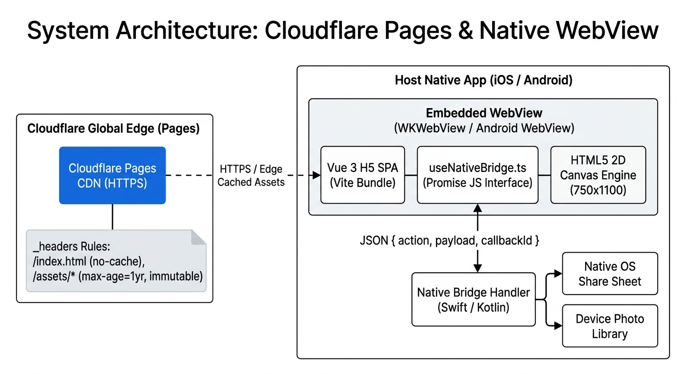
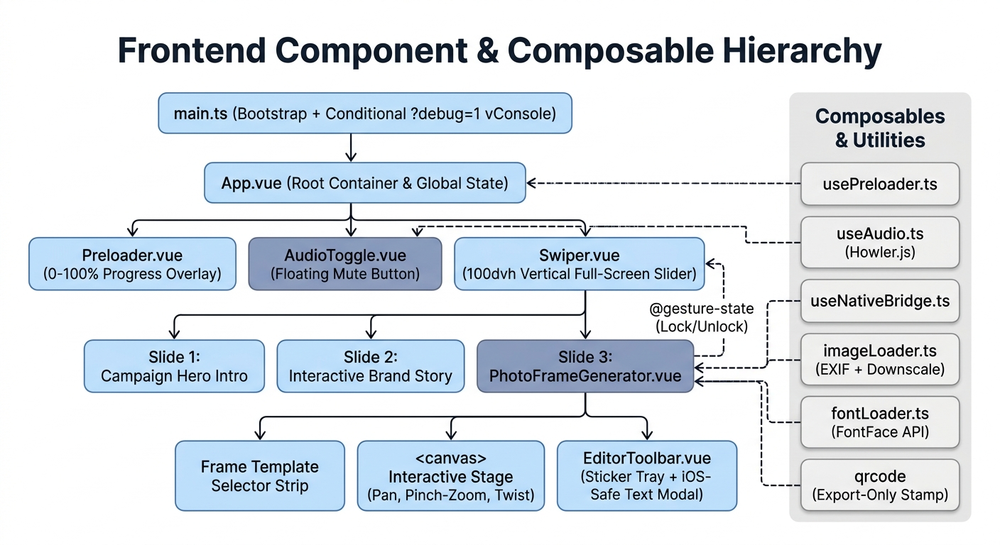

# H5 Interactive Marketing Campaign App

A lightweight, high-performance mobile H5 web application built with **Vue 3**, **Vite**, and **TypeScript**, designed to run seamlessly inside **iOS (`WKWebView`)** and **Android (`WebView`)** custom native apps as well as mobile browsers.

---

## Key Features

- **Vertical Full-Screen Story (`100dvh`):** Smooth vertical swipe navigation powered by **Swiper.js**, locked to dynamic viewport height with safe-area padding (`env(safe-area-inset-bottom)`).
- **60fps Interactive Photo Frame Generator:**
  - Multi-touch **single-finger pan**, **two-finger pinch-to-zoom**, and **two-finger twist rotation**.
  - Multiple selectable campaign frame templates with instant in-memory caching.
  - Draggable, scalable, rotatable **stickers** and **custom text overlays** with hit-tested selection boxes and delete (`×`) handles.
  - Automatic **64KB-slice EXIF orientation normalization** and `1600px` memory-safe image downscaling for mobile camera photos.
  - Export-only **QR code corner badge** stamping (`qrcode`) and custom brand font rendering (`FontFace` API).
- **Unified Native App JSBridge (`useNativeBridge.ts`):** Standardized Promise-based communication layer supporting both iOS (`WKScriptMessageHandler`) and Android (`@JavascriptInterface`) for fetching user info, saving posters to the camera roll, and launching native OS share sheets.
- **Mobile WebView Safeguards:**
  - Asset preloader with `0–100%` progress bar (`Preloader.vue`).
  - WebView-safe background audio loop with auto-pause on app backgrounding (`Howler.js`).
  - iOS keyboard-safe modal input (`16px` font size to prevent Safari auto-zoom).
  - Conditional on-device debugging via **vConsole** (`?debug=1`).

---

## System Architecture



---

## Frontend Component & Composable Hierarchy



---

## Project Structure

```text
h5-campaign-app/
├── docs/
│   ├── architecture.png              # System architecture diagram
│   └── components.png                # Frontend component hierarchy diagram
├── native/
│   ├── ios/
│   │   └── NativeBridgeHandler.swift # iOS WKScriptMessageHandler bridge
│   └── android/
│       └── NativeBridgeInterface.kt  # Android @JavascriptInterface bridge
├── public/
│   ├── _headers                      # Cloudflare Pages cache & CORS headers
│   └── assets/
│       ├── audio/                    # Background music loops (.mp3)
│       ├── fonts/                    # Custom brand fonts (.woff2)
│       ├── frames/                   # Transparent PNG frames (750x1100px)
│       └── stickers/                 # Transparent PNG stickers (200x200px)
├── src/
│   ├── components/
│   │   ├── AudioToggle.vue           # Floating mute/unmute audio control
│   │   ├── EditorToolbar.vue         # Sticker tray & iOS-safe text modal
│   │   ├── PhotoFrameGenerator.vue   # Interactive 750x1100 HTML5 canvas editor
│   │   └── Preloader.vue             # Full-screen asset loading progress overlay
│   ├── composables/
│   │   ├── useAnalytics.ts           # Funnel event tracking via sendBeacon
│   │   ├── useAudio.ts               # Howler.js audio unlock & lifecycle manager
│   │   ├── useNativeBridge.ts        # Cross-platform iOS/Android JSBridge wrapper
│   │   └── usePreloader.ts           # Image preloading & progress tracker
│   ├── utils/
│   │   ├── fontLoader.ts             # FontFace API loader for canvas text
│   │   └── imageLoader.ts            # EXIF orientation parser & downscaler
│   ├── App.vue                       # Root Swiper container & state orchestration
│   └── main.ts                       # App bootstrap & conditional vConsole loader
├── index.html
├── package.json
├── tsconfig.json
└── vite.config.ts
```

---

## Local Development & Device Testing

### 1. Install & Run
```bash
npm install
npm run dev
```

### 2. On-Device Debugging (`vConsole`)
Append `?debug=1` to any local, staging, or production URL to inject **vConsole** on your mobile screen:
```text
http://<YOUR-LOCAL-IP>:5173/?debug=1
```

### 3. WSL2 Windows Port Forwarding (For Physical Phone Testing)
If running inside WSL2 on Windows, forward port `5173` from an Administrator PowerShell terminal so your phone can connect via your Windows Wi-Fi IP:
```powershell
netsh interface portproxy add v4tov4 listenport=5173 listenaddress=0.0.0.0 connectport=5173 connectaddress=<WSL2-IP>
New-NetFirewallRule -DisplayName "WSL2 Vite Dev Server" -Direction Inbound -LocalPort 5173 -Protocol TCP -Action Allow
```

---

## Deployment (Cloudflare Pages)

1. Push this repository to GitHub or GitLab.
2. Open **Cloudflare Dashboard → Workers & Pages → Create → Pages → Connect to Git**.
3. Configure the build settings:
   - **Framework preset:** `Vue`
   - **Build command:** `npm run build`
   - **Build output directory:** `dist`
   - **Environment variable:** `NODE_VERSION = 20`
4. Cloudflare automatically applies `public/_headers` to enforce `no-cache` on `/index.html` and immutable 1-year edge caching on `/assets/*`.

---

## Native App JSBridge API Contract

### Request Format (Web → Native)
All bridge calls invoke `window.webkit.messageHandlers.NativeAppBridge.postMessage(jsonString)` (iOS) or `window.NativeAppBridge.postMessage(jsonString)` (Android) with a serialized JSON payload:

```json
{
  "action": "saveImageToAlbum",
  "payload": {
    "image": "data:image/jpeg;base64,/9j/4AAQSkZJRg..."
  },
  "callbackId": "cb_1731880000_a1b2c"
}
```

### Response Format (Native → Web)
The native handler resolves the Promise by evaluating `window[callbackId](response)`:

```json
{
  "code": 0,
  "data": { "saved": true },
  "message": ""
}
```

| Action | Request Payload | Response `data` | Description |
| :--- | :--- | :--- | :--- |
| `getUserInfo` | `{}` | `{ userId, nickname, token }` | Fetches authenticated user profile from the host app. |
| `saveImageToAlbum` | `{ image: string }` | `{ saved: true }` | Decodes Base64 JPEG and writes it to the OS photo gallery. |
| `shareImage` | `{ image: string, title: string }` | `{ shared: true }` | Opens the native OS share sheet with the poster image and title. |
